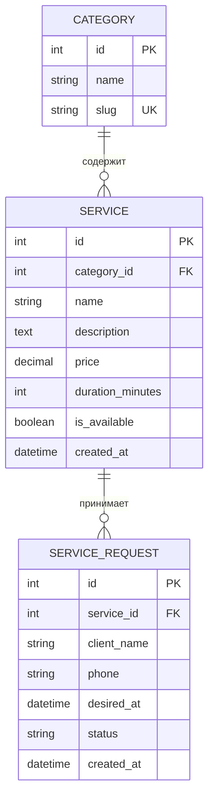

# Схема данных

Поля всех трёх таблиц обязательны и не допускают NULL. ID и дата создания задаются автоматически. У новой услуги доступность по умолчанию включена, у заявки статус по умолчанию `new`. Категория может содержать много услуг, а услуга может иметь много заявок. Удаление записей со связанными услугами или заявками защищено. База ограничивает цену значением от нуля, длительность от одной минуты и допустимые значения статуса.
